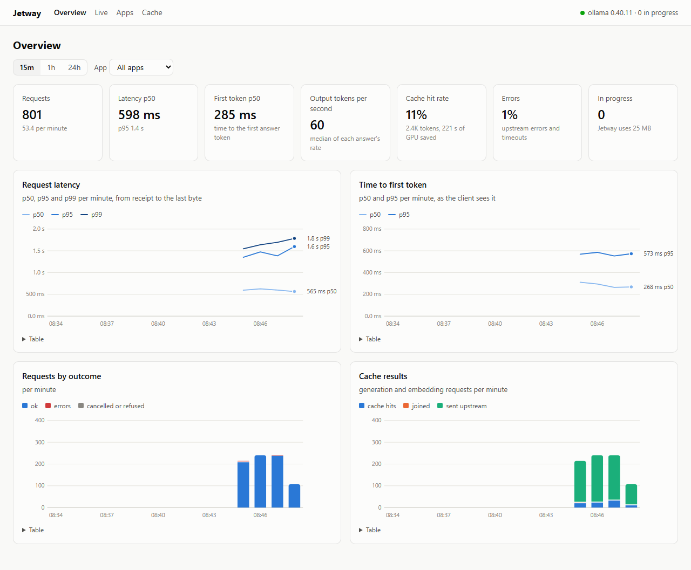

# Jetway

Jetway is an LLM gateway: a proxy between your apps and a local Ollama that makes every model call cheaper, faster
and safer. Apps point at Jetway instead of Ollama and change nothing else. It streams responses through as they
arrive, answers repeated questions from a cache, joins identical requests in flight, records every exchange, and
shows it all on a live dashboard. One Rust binary; it speaks Ollama's API and the OpenAI-compatible API.

> **Status:** in development. The MVP is done (phases 0–4: streaming pass-through, request log and metrics, exact
> cache with joined requests, dashboard). Next: real clients (phase 5), then the semantic cache, guards for personal
> data and prompt injection, thinking on/off routing, and budgets. See the [implementation plan](docs/plan/README.md).



## What works today

- **Pass-through for both APIs.** `/api/chat`, `/api/generate`, `/api/embed`, `/v1/chat/completions`,
  `/v1/completions`, `/v1/embeddings` and the model-info endpoints, streamed chunk by chunk. Jetway adds about
  0.1 ms per request (p50; 0.14 ms p99) on this PC. A client that disconnects stops Ollama's generation.
- **Per-app traffic.** Apps are told apart by a path prefix (`http://127.0.0.1:8300/a/my-app/`), an `X-Jetway-App`
  header or a bearer key; model management (`pull`, `delete`, ...) is refused unless an app is marked admin.
- **An exact cache.** A repeated request is answered in about 0.2 ms, in the client's protocol and stream mode,
  without touching the GPU; entries survive restarts. Identical requests that arrive while the first is running
  share its one upstream call.
- **A request log.** Every exchange is one SQLite row with token counts, time to first token and Ollama's own
  durations, with bodies kept for a week. Prometheus metrics on `/metrics`; OpenTelemetry spans if configured.
- **A dashboard** on `http://127.0.0.1:8301`: overview, live feed, each exchange in detail, apps and the cache.

## Quick start

```bash
cargo run --release -- serve          # gateway on 127.0.0.1:8300 → Ollama on 127.0.0.1:11434; dashboard on :8301
```

Then point a client at Jetway instead of Ollama:

```bash
OLLAMA_HOST=127.0.0.1:8300 ollama run qwen3.5:4b "Name the capital of France."
```

```python
ollama.Client(host="http://127.0.0.1:8300/a/my-app")                         # the Python ollama client
OpenAI(base_url="http://127.0.0.1:8300/a/my-app/v1", api_key="unused")       # any OpenAI client
```

For a .NET app using OllamaSharp, set its base address to `http://127.0.0.1:8300/a/my-app/`.

### Without a GPU

```bash
cargo run --release -- fake-ollama --port 8399                    # answers from recorded Ollama responses
JETWAY__UPSTREAM__URL=http://127.0.0.1:8399 cargo run --release -- serve
cargo run --release -- load --rate 5 --duration 120 --fake        # demo traffic over three apps
```

## Commands

```bash
jetway serve                                  # the gateway and the dashboard
jetway check-config                           # defaults, then jetway.toml, then JETWAY__* variables, validated
jetway requests tail -f [--app A]             # the request log as it grows; `requests show <id> --bodies`
jetway cache stats | cache list | cache clear [--app A]
jetway db migrate | db prune --older-than 7d
jetway fake-ollama | load                     # development and demos
```

Configuration lives in [`jetway.toml`](jetway.toml); every value can be overridden with an environment variable
(`JETWAY__SERVER__PORT=9000` sets `server.port`).

## Building

Rust 1.99 (pinned in `rust-toolchain.toml`; rustup installs it on first use). On Windows, the MSVC build tools from
Visual Studio are needed.

```bash
cargo build
cargo test                                    # never needs Ollama or a GPU
cargo bench --bench overhead                  # the latency Jetway adds, per request and per chunk
```

## Licence

Licensed under either of [Apache License, Version 2.0](LICENSE-APACHE) or [MIT license](LICENSE-MIT) at your option.
