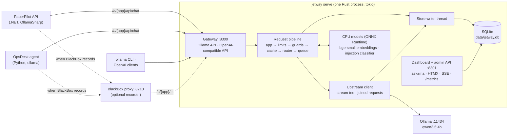

# Jetway: implementation plan

Jetway is an LLM gateway: a proxy between apps and their local model that makes every model call cheaper, faster and
safer. Apps point at Jetway instead of Ollama and change nothing else. Jetway streams every response through as it
arrives, answers repeated requests from an exact cache and paraphrased questions from a semantic cache, joins
identical requests that are already in flight, flags or blocks prompt injection and personal data, decides whether a
request needs the model's thinking mode, enforces per-app token budgets and rate limits, queues requests by priority,
and shows all of it live on a dashboard.

Jetway is one Rust binary. It speaks Ollama's own API and Ollama's OpenAI-compatible API, so it works with PaperPilot
(.NET, OllamaSharp), BlackBox's OpsDesk agent (Python, `ollama`), the `ollama` CLI and any OpenAI client.

> **Status (2026-10-26):** plan approved; phases 0–4 done, so **the MVP is complete** (pass-through, request log,
> exact cache, dashboard); phase 5 (real clients) next.

| File | What it covers |
|---|---|
| [README.md](README.md) | Decisions, architecture, repo layout, crates, configuration, conventions, phases, risks, definition of done |
| [phase-0-bootstrap.md](phase-0-bootstrap.md) | Toolchain, repo, Cargo project, CI, and four spikes that check the riskiest assumptions |
| [phase-1-pass-through.md](phase-1-pass-through.md) | Streaming pass-through proxy for both APIs, app identity, errors, cancellation, fake Ollama |
| [phase-2-request-log.md](phase-2-request-log.md) | Protocol parsers, exchange records, SQLite writer, metrics, Prometheus, OpenTelemetry |
| [phase-3-exact-cache.md](phase-3-exact-cache.md) | Exact-match cache in both APIs and both stream modes, persistence, request coalescing |
| [phase-4-dashboard.md](phase-4-dashboard.md) | Live dashboard and admin API. **The MVP is complete here.** |
| [phase-5-real-clients.md](phase-5-real-clients.md) | PaperPilot, OpsDesk and the `ollama` CLI through Jetway; BlackBox in the chain; first measurements |
| [phase-6-semantic-cache.md](phase-6-semantic-cache.md) | Embeddings on the CPU, query slots, semantic index, threshold tuned by a reviewed eval set |
| [phase-7-guards.md](phase-7-guards.md) | Personal-data detection and redaction, prompt-injection classifier, guard evals |
| [phase-8-routing.md](phase-8-routing.md) | Thinking on or off for `qwen3.5:4b`, model aliases, router trained and evaluated on checkable questions |
| [phase-9-limits.md](phase-9-limits.md) | Rate limits, token and GPU-time budgets, priority queue, load shedding, circuit breaker, alerts |
| [phase-10-load-payoff.md](phase-10-load-payoff.md) | Load and resilience tests, hardening, release builds, the payoff report with real apps |

---

## 1. Decisions

D2 (licence), D6 (routing), D7 (dashboard) and D20 (Rust notes) were chosen by you on 2026-10-25. The others are
recommendations; change any of them here during review.

| # | Decision | Choice | Notes |
|---|---|---|---|
| D1 | Language | **Rust only**, stable 1.99, edition 2024 | Pinned in `rust-toolchain.toml`; MSVC toolchain on Windows. Tools that would usually be scripts (fake Ollama, load generator, eval runners) are `jetway` subcommands, so the repo stays in one language. The dashboard is server-rendered HTML with HTMX; no JavaScript is written. |
| D2 | Repo and licence | **`github.com/arunmariappan/Jetway`**, cloned at `D:\ai_workspace\Jetway`; **MIT OR Apache-2.0** | Public. Dual licence, as most Rust crates use (`LICENSE-MIT`, `LICENSE-APACHE`). Work on `main`, one small conventional commit per task, pushed. Repo-local noreply identity. Commit messages have no attribution trailer. |
| D3 | Processes and ports | **One process, `jetway serve`** | Gateway on 8300 (Ollama and OpenAI-compatible APIs), dashboard, admin API and `/metrics` on 8301. A separate admin port keeps dashboard paths from ever colliding with model API paths. |
| D4 | APIs | **Ollama's native API and Ollama's OpenAI-compatible API, each passed to the same API upstream** | Jetway never translates one protocol into the other. It reads what it needs from each (model, messages, options, stream flag, token counts) and can write responses in each, which cache hits and blocks need. An explicit allow-list of paths: generation, embeddings and model info are forwarded; model management (`pull`, `delete`, `create`, ...) is refused unless the app is marked `admin`; anything else is 404. |
| D5 | Upstream and model | **The host Ollama at `http://127.0.0.1:11434`, model `qwen3.5:4b`** | Jetway forwards whatever model a request names. Its own model calls (drafting eval data, router training answers) use `qwen3.5:4b` with `think` off, through Jetway itself as app `jetway`, so they are logged and cached too. |
| D6 | Routing | **Thinking on or off for `qwen3.5:4b`** (your choice) | Same weights, so no extra video memory. Requests opt in with the virtual model `jetway/auto`, or an app opts in with `route = "auto"` (then only requests that don't set `think` are routed). A logistic-regression router on the semantic cache's embedding plus a few text features decides; it is trained and evaluated on questions with checkable answers (phase 8). Thinking that the client didn't ask for is stripped from the response. |
| D7 | Dashboard | **Askama templates + HTMX + server-sent events; charts drawn as SVG on the server with `plotters`** (your choice) | Assets (HTMX, its SSE extension, one stylesheet) are embedded in the binary, so it works offline. Prometheus `/metrics` on the admin port as well. |
| D8 | Storage | **SQLite in WAL mode, one file (`data/jetway.db`)** via `rusqlite` (bundled SQLite) | One writer thread owns the write connection and takes records from a bounded channel in batches. The request path never waits for the database: when the channel is full, the record is dropped and counted. Bodies are stored zstd-compressed; policy `none`, `errors` or `all`; 7 days' retention by default. |
| D9 | Caches | **Exact cache (phase 3) and semantic cache (phase 6), per app by default** | Exact: a blake3 hash of the canonical request; entries held in memory (`moka`, bounded by bytes) and persisted in SQLite, so a restart keeps them. Semantic: a brute-force cosine search over normalised vectors per partition, in memory and persisted; enough for tens of thousands of entries, so no approximate index is needed. Hits are served in the client's own protocol and stream mode. |
| D10 | Embeddings | **`fastembed` on the CPU, fp32: `BAAI/bge-small-en-v1.5` or `all-MiniLM-L6-v2` (384 dimensions), chosen by phase 6's eval** | bge-small is the model BlackBox uses; MiniLM-L6 is about twice as fast here (spike S2: 11 against 21 ms for a 64-token text). int8 is slower on this Zen 2 CPU. Both leave the GPU to Ollama; a second model on the GPU would slow both. Only the short question part of a request is embedded, never a whole 4K-token RAG prompt. |
| D11 | Guards | **Personal data: regular expressions with checksum validators. Prompt injection: a small classifier in ONNX Runtime on the CPU** | Actions per app: personal data `off`, `flag`, `redact` or `block`; injection `off`, `monitor` or `enforce`. Defaults are `flag` and `monitor`, which never change a request and add no latency: monitor runs the classifier alongside the upstream call. The classifier, picked in spike S3, is **`Horizon-Labs/prompt-injection-guard-small`** (Apache-2.0, int8 ONNX, about 400 MB in memory): 44 ms for 64 tokens, no false positive on 30 research questions about prompt injection, all 10 research-style attacks caught. |
| D12 | App identity | **Path prefix `/a/{app}/`, else the `X-Jetway-App` header, else a bearer key mapped to an app, else `default`** | The prefix needs no client code: PaperPilot's connection string and BlackBox's upstream target both take a base URL with a path. Keys are labels for OpenAI clients, not security; Jetway listens on 127.0.0.1 only. |
| D13 | Budgets and limits | **Per app: requests per minute, tokens per day and month, GPU-seconds per day** | GPU-seconds come from Ollama's `total_duration` and stand in for cost, since local calls cost nothing in money. Cache hits use no budget and count as saved. Exceeded limits return 429 with `Retry-After` in the client's own error format. |
| D14 | Scheduling | **A per-upstream slot limit with a priority queue; identical in-flight requests are joined** | Ollama answers about one request at a time on this card (spike S1 measures it). Requests wait for a slot by priority (`interactive`, `normal`, `batch`, with aging), are refused with 503 when they would wait too long, and leave the queue without an upstream call when the client disconnects. A request identical to one in flight joins it and receives the same stream. |
| D15 | Streaming rules | **Nothing is buffered on the way to the client** | Each upstream chunk is handed on as soon as it arrives; a reference-counted copy (no byte copying) goes to the recorder, which reassembles lines on its own. Upstream silence is limited by an idle timeout, not a total one. When the client disconnects, the upstream call is dropped so Ollama stops generating, unless other joined clients still read it. A failure mid-stream ends the stream with an error line in the protocol's own form, as Ollama does. |
| D16 | Tracing | **`tracing` for logs; OpenTelemetry spans with the GenAI conventions, exported over OTLP/HTTP when configured** | Off by default. Jetway continues the incoming `traceparent`, so its spans join the app's trace in the Aspire dashboard or in BlackBox. When BlackBox records an agent, BlackBox sits between the agent and Jetway (agent → BlackBox → Jetway → Ollama), so BlackBox records exactly what the agent saw, including cache hits. |
| D17 | Network | **Listens on 127.0.0.1 only; upstream URLs use `127.0.0.1`, not `localhost`; `TCP_NODELAY` on every socket** | Windows resolves `localhost` to `::1` first, and a refused IPv6 connection costs about 2 seconds (found in PaperPilot). Without `TCP_NODELAY`, small stream chunks wait about 40 ms for a delayed ACK (found in BlackBox). |
| D18 | Tests and CI | **No GPU or Ollama in tests; GitHub Actions on Ubuntu and Windows** | Tests run against `jetway fake-ollama`, which replays real responses recorded in spike S1 with scripted timing, errors and drops. CI uses a hashing embedder and a stub classifier, so no model is downloaded. CI runs format, Clippy with warnings as errors, tests and `cargo-deny` (licences, advisories). |
| D19 | Evals | **Every ML decision has a committed eval and report** | Semantic-cache precision and recall against the threshold, injection and personal-data precision, recall and false-positive rate, router accuracy against latency. Datasets live in `evals/`, reports in `reports/`. Thresholds in `jetway.toml` come from these reports, never from guesses. |
| D21 | OpenAI stream usage | **Jetway asks for usage in OpenAI streams and hides it from clients that didn't ask** (decided in phase 2) | Ollama sends token counts in an OpenAI stream only with `stream_options.include_usage` (spike S1). Jetway adds it upstream and removes the usage-only event (`choices: []`) on the way out, so every stream has exact token counts for the log and budgets. Whole events pass untouched; only an event split across chunks waits for its end. |
| D20 | Rust notes | **Claude writes and tests the code; each phase's "What was built" section ends with "Rust notes"** (your choice) | A few short explanations of the Rust ideas the phase used (for example ownership in the stream tee, `Send` and `Sync`, async cancellation, `spawn_blocking`), each with links to the code. Jetway is the warm-up for AirMarshal, so the notes build up what that project needs. |

### Goals
- **Pass-through:** any Ollama or OpenAI client works through Jetway exactly as it does against Ollama, and streams
  are never broken or held back.
- **Fast:** under 1 ms added per request at p99 on a quiet machine, under 2 ms at 200 concurrent streams.
- **Cheaper:** exact and semantic cache hits, joined in-flight requests, and thinking only where it helps.
- **Safer:** personal data and prompt injection flagged, redacted or blocked per app.
- **Fair:** per-app budgets, rate limits and priorities, with load shedding instead of unbounded queues.
- **Visible:** a live dashboard of latency, time to first token, tokens, cache hits, guard verdicts and budgets.
- **MVP** (end of phase 4): a pass-through proxy with streaming, an exact-match cache and a latency dashboard.
- **Payoff** (phases 5 and 10): PaperPilot and OpsDesk run behind Jetway, and a report measures cache hits, time saved,
  overhead and unchanged quality.

### Non-goals
- Hosted model providers. The upstream is the local Ollama; an OpenAI-compatible upstream would probably work but
  isn't tested.
- Authentication or multi-user security. Jetway listens on 127.0.0.1 only; app keys are labels.
- Translating between Ollama's API and OpenAI's.
- Serving models itself (that's Ramjet, #15) or guarding agents' tool calls (that's AirMarshal, #11).
- Fine-tuning language models. The router is a logistic regression trained on the CPU in seconds.
- Semantic caching or scanning of images. Image inputs pass through and are part of the exact cache key.
- Clusters, several Jetway instances or Kubernetes.

---

## 2. Architecture



### How a request is handled
1. **App:** Jetway takes the app from the path prefix, header or key (D12) and strips the prefix.
2. **Parse:** it reads the request leniently: only the fields it needs (model, messages or prompt, options, `stream`,
   `think`, `format`, `tools`). It keeps the raw bytes, so unknown fields reach Ollama untouched.
3. **Limits:** the rate limit and budgets are checked (phase 9). Refused requests get 429 at once.
4. **Guards:** personal-data checks run inline in microseconds; the injection classifier runs inline in `enforce`
   mode or alongside the upstream call in `monitor` mode (phase 7). A block returns an error in the client's format.
5. **Cache:** the exact key is looked up (phase 3); on a miss, the semantic index (phase 6). A hit is written in the
   client's protocol and stream mode. On a miss, if an identical request is in flight, this one joins it.
6. **Route:** for `jetway/auto` or an opted-in app, the router decides `think` on or off; model aliases apply
   (phase 8).
7. **Queue:** the request waits for an upstream slot by priority, or is refused with 503 if it would wait too long
   (phase 9).
8. **Upstream:** the request goes to Ollama; each response chunk is forwarded the moment it arrives and also handed to
   the recorder.
9. **After:** the recorder parses the final statistics (token counts, durations); the cache stores a complete
   successful answer; the exchange record goes to the writer; metrics, budgets and the live feed are updated.

### Terms

| Term | Meaning |
|---|---|
| App | A client of Jetway with its own policy (cache, guards, budgets, priority, route), named by D12 |
| Exchange | One request and its response through Jetway; one record, one ULID, returned in `X-Jetway-Id` |
| Upstream | The Ollama server Jetway forwards to |
| Slot | One upstream request that may run at a time; waiting requests queue for a slot |
| Cache key | The blake3 hash of a request's canonical form, without fields that don't change the answer |
| Joined request | A request identical to one in flight, served from the same upstream stream |
| Query slot | The part of a request that may differ between paraphrases, usually the user's question |
| Partition | Everything in a request except its query slot; semantic matches are searched only within one partition |
| Template | A per-app pattern that finds the query slot inside a prompt built from a template, such as PaperPilot's |
| Verdict | One guard's finding on one exchange: kind, score, location, action taken |
| Route | The router's decision for one exchange: thinking on or off, with its probability and reason |
| Budget | A per-app allowance of requests, tokens or GPU-seconds over a period |

---

## 3. Repository layout

```
Jetway/
├── Cargo.toml, Cargo.lock    # one package: library + `jetway` binary
├── rust-toolchain.toml       # stable 1.99, rustfmt, clippy
├── jetway.toml               # committed defaults (ports, upstream, apps, cache, guards, budgets)
├── .env.example              # optional secrets (Telegram); `.env` itself is gitignored
├── deny.toml                 # cargo-deny: licences, advisories, duplicate crates
├── README.md, CLAUDE.md, LICENSE-MIT, LICENSE-APACHE
├── docs/plan/                # this plan
├── src/
│   ├── main.rs               # clap: serve, check-config, requests, cache, db, models, eval, dataset, router, load, fake-ollama
│   ├── lib.rs
│   ├── config.rs             # figment: jetway.toml, then JETWAY__* environment variables; validation
│   ├── server/               # gateway and admin listeners, app identity, path allow-list, shutdown
│   ├── proxy/                # upstream client, stream tee, timeouts, cancellation, header rules, error bodies
│   ├── protocol/             # ollama.rs, openai.rs: lenient request/response models, NDJSON and SSE decoders, writers
│   ├── store/                # schema, migrations, writer thread, queries, retention
│   ├── metrics/              # rollups, histograms, Prometheus exporter
│   ├── telemetry/            # tracing subscriber, OpenTelemetry spans and export
│   ├── cache/                # key, exact store, joined requests, semantic slots, partitions, index
│   ├── embed/                # Embedder trait, fastembed, hashing embedder for tests
│   ├── guards/               # framework, pii/, injection/ (ort + tokenizers)
│   ├── router/               # aliases, features, model, decisions, thinking stripper
│   ├── limits/               # rate limits, budgets, scheduler, circuit breaker
│   ├── alerts/               # rules, dashboard banner, optional Telegram
│   ├── web/                  # dashboard handlers, charts (plotters), admin JSON API
│   └── dev/                  # fake Ollama, load generator, eval and dataset runners
├── templates/                # askama templates
├── assets/                   # css; vendor/ htmx and its SSE extension (embedded in the binary)
├── evals/                    # datasets (JSONL): semantic/, injection/, pii/, router/
├── reports/                  # eval, load and payoff reports
├── benches/                  # overhead benchmarks
├── tests/                    # integration tests: gateway in-process, fake Ollama on a free port
│   └── fixtures/             # recorded Ollama responses (S1), PaperPilot requests (phase 5)
└── data/                     # gitignored: jetway.db, models/
```

---

## 4. Crates

Use the newest stable version of each when its phase starts, and let `Cargo.lock` pin them.

| Concern | Crate(s) |
|---|---|
| Async runtime | `tokio` (multi-thread), `tokio-util`, `futures` |
| HTTP server | `axum`, `tower`, `tower-http` (tracing, request limits) |
| HTTP client (upstream, Telegram) | `reqwest` (`stream`, `rustls-tls`), `bytes` |
| Serialisation | `serde`, `serde_json` |
| Configuration | `figment` (`toml`, `env`) |
| CLI | `clap` (derive) |
| Errors | `thiserror` in the library, `anyhow` in `main.rs` and dev tools |
| Logs and traces | `tracing`, `tracing-subscriber`; spans encoded with `opentelemetry-proto` and `prost` and posted by Jetway (phase 2: the SDK's thread-based exporter isn't needed for spans built after the fact) |
| Storage | `rusqlite` (`bundled`; migrations are Jetway's own, `user_version`-based), `zstd` |
| Hashing, IDs, time | `blake3`, `ulid`, `jiff` |
| Cache | `moka` (`sync`: a lookup never waits), `blake3` |
| Embeddings | `fastembed` (ONNX Runtime through `ort`) |
| Injection classifier | `ort`, `tokenizers` |
| Personal data | `regex` |
| Router | `linfa`, `linfa-logistic`, `ndarray` |
| Limits | `governor` |
| Metrics | `hdrhistogram`, `memory-stats`; Prometheus text rendered by Jetway (phase 2) |
| Dashboard | `askama` + `askama_web`, `rust-embed`; charts are hand-written SVG (phase 4: `plotters` writes fixed colours) |
| Load generator | `rand`, `hdrhistogram` |
| Dev | `insta` (snapshots), `proptest`, `criterion`, `tempfile` |
| Tools (installed, not dependencies) | `cargo-deny` |

---

## 5. Configuration and ports

`jetway.toml` holds committed defaults; environment variables (`JETWAY__SERVER__PORT=...`) override them, and `.env`
holds the optional secrets. Validation fails at startup with a clear message on bad values (`jetway check-config`
runs it alone).

```toml
[server]
host = "127.0.0.1"
port = 8300                        # gateway: Ollama and OpenAI-compatible APIs
admin_port = 8301                  # dashboard, admin API, /metrics
max_request_bytes = 67_108_864     # 64 MiB; image inputs are base64
shutdown_grace_seconds = 30

[upstream]
name = "ollama"
url = "http://127.0.0.1:11434"
connect_timeout_ms = 2000
first_byte_timeout_seconds = 600   # long prompts on a busy GPU
idle_timeout_seconds = 120         # longest silence between stream chunks
slots = 1                          # requests sent at once; spike S1 measures Ollama's parallelism (phase 9)

[store]
path = "data/jetway.db"
bodies = "all"                     # none | errors | all (zstd)
retention_days = 7

[models]
default = "qwen3.5:4b"
aliases = {}                       # e.g. { "qwen3.5:9b" = "qwen3.5:4b" } (phase 8)
virtual = "jetway/auto"            # the router's model name (phase 8)

[cache]                            # phase 3
exact = true
shared = false                     # true: apps share entries
max_memory_bytes = 268_435_456
ttl_hours = 168
sampled = "allow"                  # allow | skip: requests with temperature > 0 and no seed
replay = "instant"                 # instant | paced (original token rate)

[cache.semantic]                   # phase 6
enabled = false
model = "BAAI/bge-small-en-v1.5"
threshold = 0.0                    # set from reports/semantic-cache.md; 0.0 means "not tuned", refused at startup
lexical_guard = true

[guards]                           # phase 7
pii = "flag"                       # off | flag | redact | block
injection = "monitor"              # off | monitor | enforce
injection_threshold = 0.0          # set from reports/guards.md
scan = "user"                      # user | all (all adds system, assistant and tool content)

[queue]                            # phase 9
max_wait_seconds = { interactive = 30, normal = 120, batch = 900 }

[budgets]                          # phase 9
time_zone = "system"               # when daily and monthly budgets reset

[otel]                             # phase 2
endpoint = ""                      # e.g. "http://127.0.0.1:8200" (BlackBox) or the Aspire dashboard's OTLP/HTTP port

[apps.default]
priority = "normal"

[apps.paperpilot]                  # phases 5-9
priority = "interactive"
requests_per_minute = 120
tokens_per_day = 3_000_000
gpu_seconds_per_day = 7200
# semantic templates are added in phase 6

[apps.opsdesk]
priority = "normal"

[apps.jetway]                      # Jetway's own calls (eval drafts, router training)
priority = "batch"
```

Ports avoid PaperPilot's (8100–8102, 5442, 6390, 9210, 5610, 5011, 3010, 17205) and BlackBox's (8200, 8210–8213,
8220, 8221, 8299). Checked free on 2026-10-25.

| Port | What |
|---|---|
| 8300 | Gateway → Ollama (11434) |
| 8301 | Dashboard, admin JSON API, Prometheus `/metrics` |
| 8399 | `jetway fake-ollama` (development and load tests only) |

---

## 6. Conventions

- **Commits:** on `main`, small, one per task, conventional prefixes (`feat:`, `fix:`, `test:`, `docs:`, `chore:`,
  `ci:`), pushed. No attribution trailer. Changes to PaperPilot or BlackBox, if any are needed, are committed in their
  own repos under their own conventions, after asking.
- **Style:** `cargo fmt`; `cargo clippy --all-targets -- -D warnings`; `#![forbid(unsafe_code)]`; no `unwrap()` or
  `expect()` outside tests and startup (Clippy's `unwrap_used` denied in `src/`). Errors are `thiserror` enums per
  module; `anyhow` only in `main.rs` and dev tools.
- **Never block the runtime:** SQLite writes run on their own thread, reads in `spawn_blocking`; ONNX inference runs
  in `spawn_blocking` behind a semaphore; no `std::sync::Mutex` guard is held across an `.await`.
- **Hot path:** forwarded bytes are never re-serialised; per-chunk work is a reference-count increment and a channel
  send. Anything slower (parsing, hashing, logging) happens off the forward path or after the response.
- **Time:** UTC in storage (epoch milliseconds); durations in microseconds internally; time zone only for budget
  resets (D13).
- **IDs:** ULIDs for exchanges and cache entries; trace ids as lowercase hex.
- **Jetway's own model calls:** a JSON schema in Ollama's `format`, validation, one retry, then an explicit `invalid`
  result. Nothing silently falls back to a default.
- **No silent failures:** dropped log records, failed cache writes and guard errors are counted and shown on the
  dashboard.
- **Tests:** each phase ships its tests. Unit and integration tests never need Ollama, a GPU or a downloaded model.
  Tests that do (real classifier, real embedder) are `#[ignore]` and run locally with `cargo test -- --ignored`.
- **GPU runs:** anything longer than a few minutes of model calls (eval drafts, router training, payoff sessions) is
  agreed with you first, because this PC has shut down during long GPU runs. Such runs are batched and resumable.
- **Formatting of files:** LF line endings (`.gitattributes`, since Git here has `core.autocrlf=true`).
- **Rust notes (D20):** each phase's "What was built" section ends with a short "Rust notes" list with links to code.

---

## 7. Phase overview

| Phase | Outcome | Size | Depends on |
|---|---|---|---|
| [0 Bootstrap](phase-0-bootstrap.md) | Toolchain, repo, Cargo project, CI; spikes settle Ollama's stream behaviour, fastembed and ONNX Runtime on Windows, the injection classifier, OllamaSharp's base path | S | none |
| [1 Pass-through](phase-1-pass-through.md) | Both APIs forwarded with streaming, app identity, allow-list, errors, cancellation, fake Ollama, overhead bench | M | 0 |
| [2 Request log](phase-2-request-log.md) | Protocol parsers, one record per exchange, SQLite writer, rollups, Prometheus, OpenTelemetry, `requests` CLI | M | 1 |
| [3 Exact cache](phase-3-exact-cache.md) | Canonical keys, cacheability rules, hits in both protocols and stream modes, persistence, joined requests | M | 2 |
| [4 Dashboard](phase-4-dashboard.md) | Overview, live feed, exchange detail, apps, cache pages; admin JSON API. **MVP complete.** | M | 2, 3 |
| [5 Real clients](phase-5-real-clients.md) | PaperPilot, OpsDesk and the `ollama` CLI through Jetway; BlackBox in the chain; request fixtures; first report | S | 4 |
| [6 Semantic cache](phase-6-semantic-cache.md) | Embedder, query slots and templates, partitions, index, lexical guard, reviewed eval set, tuned threshold | L | 3, 5 |
| [7 Guards](phase-7-guards.md) | Personal-data detectors and redaction, injection classifier in monitor and enforce modes, guard evals | M | 2, 5 |
| [8 Routing](phase-8-routing.md) | `jetway/auto`, aliases, thinking stripped, features, router trained and evaluated on checkable questions | M | 6 |
| [9 Limits](phase-9-limits.md) | Rate limits, budgets, priority queue with shedding, circuit breaker, alerts | M | 3 |
| [10 Load and payoff](phase-10-load-payoff.md) | Load and resilience tests, hardening, release builds, payoff report, final docs | M | all |

Phases 7 and 9 are independent of 6 and 8 and can be done in any order after phase 5. The MVP is phases 0–4;
phase 5 is the first payoff.

---

## 8. Top risks

| # | Risk | Mitigation | Where |
|---|---|---|---|
| R1 | **Jetway breaks or delays streams**, which defeats its purpose. | No buffering on the forward path (D15), `TCP_NODELAY`, chunk-timing tests against the fake Ollama, an overhead bench with targets, and a soak test that counts broken streams. | 1, 10 |
| R2 | **A semantic cache hit serves the wrong answer**, for example "How does BERT work?" answered with the GPT answer. | Precision first: threshold chosen for precision ≥ 0.98 on reviewed pairs; a lexical guard on names and numbers; matches only within one partition, so a different RAG context never matches; every hit names its source on the dashboard; a "wrong hit" button removes it and adds the pair to the eval set. | 6 |
| R3 | **Caching sampled answers** (PaperPilot answers at temperature 0.7) makes repeated questions always get the same answer. | A per-app policy (`sampled`: `allow` or `skip`), documented; PaperPilot already caches its own answers the same way. Request headers can skip the cache. | 3 |
| R4 | **ONNX Runtime and model downloads on Windows and CI** (the `ort` binaries, Hugging Face downloads, MSVC runtime). | Spike S2 builds and measures it on this PC first. CI never downloads a model: tests use a hashing embedder and a stub classifier, and real-model tests are `#[ignore]`. | 0, 6, 7 |
| R5 | **Injection false positives on research questions.** PaperPilot is about AI papers, and papers about prompt injection read like attacks. | `monitor` by default; user messages only by default; a benign set of research questions about jailbreaks in the eval; threshold chosen for ≤ 1% false positives on it. | 7 |
| R6 | **Router training needs long GPU runs:** every training question is answered with thinking off and on, and thinking is slow. | About 300 questions in agreed, capped, resumable batches; answers go through Jetway's own cache, so a re-run costs nothing. | 8 |
| R7 | **Memory:** Docker (PaperPilot's stack), Ollama and its prompt cache share 16 GB. | Small CPU models (bge-small about 130 MB, the classifier quantised where possible), loaded only when their feature is on; Jetway's own memory on the dashboard; measured in phase 10. | 6, 7, 10 |
| R8 | **Ollama's concurrency isn't what the scheduler assumes** (parallel slots, queueing inside Ollama, model reloads). | Spike S1 measures it; `upstream.slots` is configurable; cold starts are recorded from `load_duration`. | 0, 9 |
| R9 | **Protocol drift:** Ollama adds or changes fields, or its OpenAI compatibility differs from OpenAI. | Lenient parsing that reads only what Jetway needs and forwards raw bytes; golden files from the installed Ollama; the Ollama version on the dashboard. | 1, 2 |
| R10 | **Learning curve and compile times** (Rust on Windows, a large dependency tree, Defender scanning `target/`). | Rust notes per phase (D20); optimised dependencies in dev builds; heavy crates only in the phases that need them; a Defender exclusion for `target/` if you agree. | all |
| R11 | **Secrets or personal data in stored bodies** (bearer keys, users' messages). | `Authorization` is never stored or forwarded; bodies can be stored redacted (phase 7) or not at all (`bodies = none`); the database lives in gitignored `data/`. | 2, 7 |
| R12 | **The BlackBox chain misbehaves** (trace ids, cache hits confusing replays). | BlackBox sits in front of Jetway (D16), so its tapes hold what the agent saw; checked in phase 5 with a recorded and replayed run. | 5 |

---

## 9. Definition of done (whole project)

- [ ] `jetway serve` starts the gateway and dashboard; `jetway --help` lists every command.
- [ ] PaperPilot, OpsDesk, the `ollama` CLI and an OpenAI client work through Jetway with no code changes, streaming
      included.
- [ ] Overhead targets met: p99 under 1 ms added on a quiet machine, under 2 ms at 200 concurrent streams; no broken
      stream in a 30-minute soak.
- [ ] Every exchange, including failures and cancellations, has one record with correct token counts.
- [ ] Exact and semantic cache hits are served in both protocols and stream modes; the semantic threshold comes from a
      committed eval with precision ≥ 0.98.
- [ ] Personal data is flagged, redacted or blocked per app, and prompt injection is monitored or blocked per app,
      with committed eval numbers.
- [ ] `jetway/auto` routes thinking on or off, and the router report shows its accuracy and latency against always-off
      and always-on.
- [ ] Budgets, rate limits, priorities and load shedding work per app, and alerts fire.
- [ ] The dashboard shows all of the above live.
- [ ] CI runs format, Clippy, tests and `cargo-deny` on Ubuntu and Windows on every push; tagged releases attach
      Windows and Linux binaries.
- [ ] The payoff report shows cache hits, GPU time saved, overhead and unchanged quality for PaperPilot and OpsDesk.
